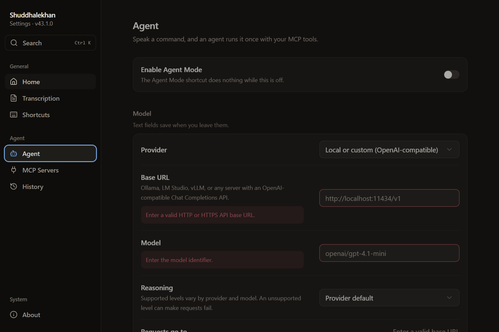
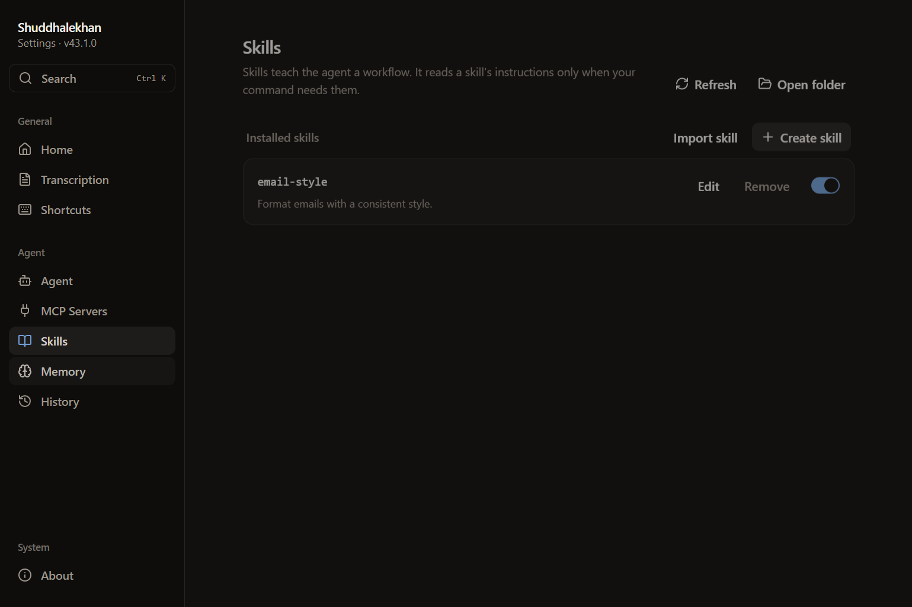
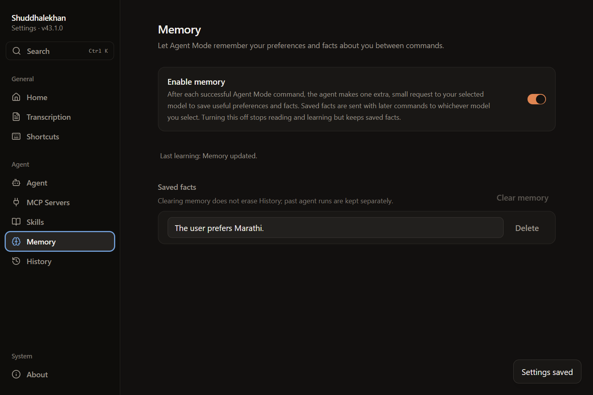

# Skills and memory dev verification

Verified in the real Electron dev app on Windows on 2026-10-13. A temporary launcher redirected both `appData` and `userData`, preserving the maintainer's normal settings, credentials, skills, and memory. Electron ran through the existing dev command with main inspection and renderer remote debugging enabled. The inspector invoked the existing voice-run entry; no debug export or probe endpoint was added to the product.

The local synthetic OpenAI-compatible provider supplied streaming and structured responses. The real sidecar and AI SDK loaded a skill, persisted a fact in `agent-memory.md`, and included that fact in the next command. Holding a learning response until after Clear memory demonstrated that the late proposal could not restore deleted facts. These probes verify application integration, not the quality of a production model's skill selection or fact extraction.

UI probes exercised skill creation, toggling, raw Markdown editing, memory enablement, fact editing, and fact deletion. File management worked with Agent Mode disabled. Both dev instances were shut down through their inspected app processes.

## Before

Actual Settings from `origin/main` at `d760dd4`, with no Skills or Memory destinations.

## After

The temporary launchers use the Electron binary's version metadata, so the images' version label is a probe artifact. No packaging build, speech-transcription service, or live model request was used.
