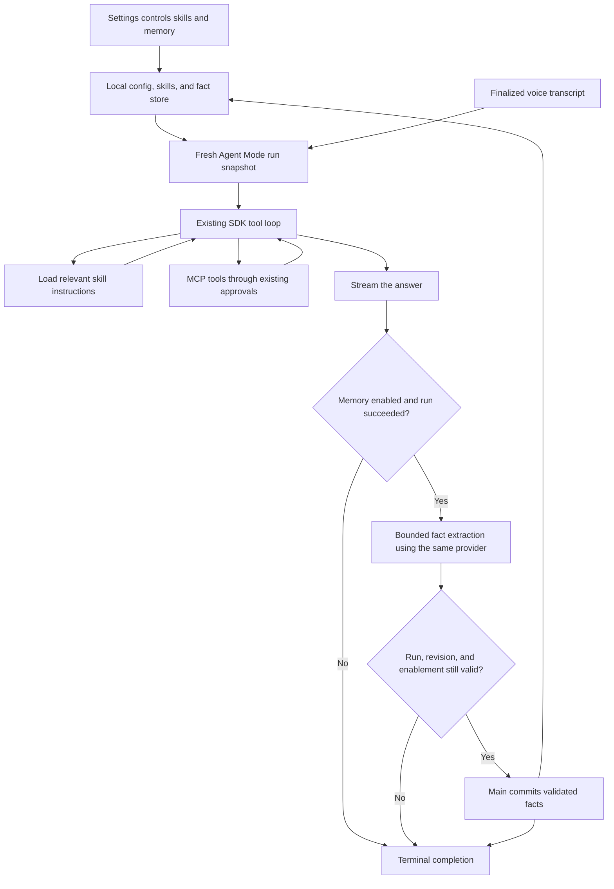

## Goal and completion condition

Users can create and manage custom skills in Settings. Shuddhalekhan stores them in its existing config directory under `skills/<name>/SKILL.md`. Agent Mode discovers enabled skills and loads relevant instructions on demand.

Users can enable persistent memory, inspect and correct what the agent remembers, and delete it. When enabled, Shuddhalekhan automatically learns useful preferences and durable facts from Agent Mode interactions and uses them in later commands, including after restarting the app.

The existing provider selection, MCP approval policy, single-flight cancellation, and Dictation behavior continue to work. Every command still starts a fresh agent run; retained facts supply context without replaying conversation history.

## Current position

Implementation is complete. The maintainer approved Markdown memory and daft-punk mode. Codex implemented persistence, runtime integration, and validation; Claude implemented the Skills and Memory Settings UI. After the maintainer requested dev testing, the real Electron app was probed with isolated app data and a local fixture provider. Before/after UI evidence is in `app/docs/research/agent-context-ui/`.

- `app/package.json` pins AI SDK `7.0.138` and already includes Zod and `electron-store`.
- `app/src/agent/runtime.ts` uses `streamText`, a stable system prompt, fresh run messages, and a five-step tool loop. Keep this runtime rather than migrating it to `ToolLoopAgent`.
- `app/src/agent/index.ts` creates per-run MCP snapshots and owns approvals and audit callbacks.
- `app/src/main/store-path.ts` already resolves the stable config directory. On Windows it is `%APPDATA%\Shuddhalekhan`, independent of Electron's development package name.
- `app/src/main/sidecar-event-router.ts` ignores stale run events. New memory messages need the same correlation and lifecycle checks.
- Settings already has an Agent navigation group, reusable settings rows, dialogs, persistence, and a typed IPC adapter.
- Agent audit logs are separate diagnostic data. Do not mine old audit history to populate memory.

## What AI SDK provides

These are documented capabilities, followed by our application-specific choices. Sources were consulted on 2026-10-13.

| Capability | Documented SDK support | Fit for Shuddhalekhan |
| --- | --- | --- |
| Provider-hosted skills | `uploadSkill` returns provider references; supported by OpenAI and Anthropic with provider-specific container tools. | Does not cover arbitrary compatible endpoints and uploads skill files. Defer this path. [SDK documentation](https://ai-sdk.dev/docs/ai-sdk-core/skill-uploads) |
| Local skills | The cookbook implements discovery, metadata in the prompt, and a standard `loadSkill` tool. | Follow this pattern using the app's local skills directory. Discovery and file management remain our code. [Skills guide](https://ai-sdk.dev/cookbook/guides/agent-skills) |
| Persistent memory | Provider-defined tools, external memory providers, or custom storage/tools. The Anthropic tool still requires an application storage implementation. | Own a small local fact store so it works across the app's providers. There is no universal local-memory switch supplied by the SDK. [Memory documentation](https://ai-sdk.dev/docs/agents/memory) |
| Structured extraction | `generateText` with `Output.object` generates and validates schema-shaped output. | Use a bounded extraction call for automatic learning. Model support and output quality must be verified. [Structured output documentation](https://ai-sdk.dev/docs/ai-sdk-core/generating-structured-data) |

The [Agent Skills specification](https://agentskills.io/specification) defines YAML frontmatter with `name` and `description`, Markdown instructions, and optional bundled resources. The SDK's [custom memory recipe](https://ai-sdk.dev/cookbook/guides/custom-memory-tool) shows how an application supplies persistence; its Bash interface is unnecessary here.

## Settled decisions and assumptions

- The maintainer selected automatic learning of useful preferences and facts when memory is enabled.
- Memory defaults to off for existing and new installs. Enabling it is explicit consent to retain facts and include them in requests to the configured provider.
- Skills are user-managed instructions. The agent cannot install or rewrite them. Loading a skill does not grant tools or bypass MCP approvals.
- The first version supports Markdown instructions and bounded reads of bundled text references. It does not introduce native script execution. A skill requiring unavailable tools must report that requirement honestly.
- Skills and memory settings remain manageable with Agent Mode disabled, without starting the sidecar.
- Settings changes apply to the next run. Disabling memory or deleting/editing facts also invalidates any pending memory proposal immediately.
- Use one application memory store shared across provider selections. Make clear in Settings that retained facts go to whichever model the user selects. Per-provider memory profiles are outside this scope.
- These are proposed implementation choices for approval, not claims that all models reliably select skills or extract correct memories.

## Storage and ownership

```text
%APPDATA%\Shuddhalekhan\
  shuddhalekhan-config.json   existing settings + disabled skill names + memory toggle
  skills\
    email-style\
      SKILL.md
      references\            optional text resources
  agent-memory.md             short Markdown fact bullets
  agent-audit.sqlite          existing audit history
```

Resolve all locations through `getPersistentStoreDirectory()`. Do not hard-code `%APPDATA%` in feature code or create an alternative development store.

Electron main owns skill file mutations and the memory store through small feature modules. Write `agent-memory.md` through a temporary file and atomic rename. Its content is a heading and short fact bullets; use a content hash plus an in-process invalidation generation for write validation, outside model-visible context. The sidecar reads skills from the main-supplied trusted root, receives a Markdown memory snapshot per run, and proposes memory changes over the existing JSONL connection. It never independently writes memory files. Main validates and serializes proposals and Settings edits, so a settings window can work while the sidecar is stopped.

Derive fact IDs from text for UI editing, and record learning provenance in the existing audit events rather than adding metadata to every Markdown bullet. Store at most 50 facts and cap model-visible fact text at 8 KiB. Update duplicate or superseded facts; when full, retain existing facts and skip additional entries with an observable capacity message rather than silently deleting them. These initial limits keep context and disk work bounded; they are implementation constants, not new Settings controls.

## Skills UX and runtime

Add a **Skills** section to the existing Agent navigation group. Show a plain list with name, description, enabled switch, and edit action. The empty state explains that skills teach the agent a workflow.

- **Create skill** opens Name, When to use it, and Instructions fields. Save generates standard YAML frontmatter and Markdown. The name is its stable folder identifier.
- **Import skill** accepts an existing skill folder containing `SKILL.md` and copies it into the app's skills folder. Show the parsed name and description before enabling it. Report conflicts without overwriting installed skills.
- **Edit** changes description and instructions. Preserve optional frontmatter fields and bundled resources; do not rewrite a richer imported skill into a lossy minimal document. Keep an advanced raw Markdown editor available for imported content.
- **Remove** confirms deletion of the app-managed copy. **Open skills folder** and **Refresh** support manual file management without requiring it for normal use.
- Show invalid files with an actionable validation message. Exclude them from runtime discovery without preventing other skills or an agent run from working.

Use a real YAML parser. `js-yaml` is already present transitively in the lockfile; declare it as a direct app dependency rather than relying on a transitive import or inventing a frontmatter parser. Use its safe data schema and Zod validation, accept optional standard metadata, and preserve it on edits.

At run start, discover enabled skill metadata in deterministic order. Keep names and descriptions in a separate skills context block so the base system prompt remains stable for provider caching. Register a namespaced internal `loadSkill` tool alongside MCP tools. Its lookup accepts a skill name, not an arbitrary path. A companion bounded resource-read tool accepts only relative text paths within that skill.

Cap the catalog at 64 enabled skills and 16 KiB of metadata. Cap each skill instruction/resource read at 32 KiB and total import size at 10 MiB; report limits without silently truncating instructions. Reject traversal, absolute/UNC/device paths, alternate data streams, symlink/junction escapes, and non-text reads. Check containment for import, read, edit, and deletion. Reads do not execute files. Reserve internal tool names so MCP names cannot collide with them.

The model chooses relevant skills from descriptions. Loading a skill consumes a tool step within the existing five-step budget. Preserve that guardrail initially and test a representative load-skill plus MCP workflow before changing it. Include skills context in the step-limit summary path as well.

## Automatic memory behavior



1. Main supplies a versioned memory snapshot with the run request. Inject its bounded facts as clearly identified remembered user context, subordinate to the current command and approval rules. Include it in the fallback summary path too.
2. After successful task generation, run at most one additional, non-streamed `generateText` call with `Output.object` and a small Zod schema. Use the same configured provider and credential handling. Give it the current facts and the current user transcript, not MCP results, skill instructions, hidden reasoning, or the audit database.
3. Extract only useful durable preferences and user-stated facts. Allow an empty proposal, update contradictions with newer explicit user statements, and exclude credentials, temporary tasks, guesses, and instructions disguised as facts. Automatic learning refers to this application-managed extraction pass, not a promise that the SDK independently remembers interactions.
4. Send the proposal with `agentRunId` and the snapshot revision. Main commits only while that run is active, memory remains enabled, and the revision matches. An edit, deletion, clear, disable, replacement run, or shutdown invalidates the proposal. Return an acknowledgment so the sidecar records a confirmed save or skip before terminal completion.
5. Limit extraction to 10 seconds, a small input/output budget, and zero automatic retries. The answer already streams, but terminal completion can be delayed by this pass. A failure, invalid structured output, unsupported model setting, or disk error leaves existing memory intact and still completes the task successfully. Report a compact memory status in Settings and the run summary when learning fails. Record separate memory usage and outcome events.

This single pass avoids adding a background queue, a second configurable model, embeddings, a vector database, or a server. It does add one model request per successful memory-enabled command and cannot guarantee fact correctness. A model that cannot produce schema-valid output can continue executing Agent Mode tasks, but automatic learning will be visibly unavailable until the provider/model is changed.

Add a **Memory** section to the Agent navigation group. Use an Enable memory switch with plain copy explaining automatic retention and the extra model call. Show editable fact rows with delete, a confirmed Clear memory action, and the most recent learning status. Turning memory off stops reading and learning but retains saved facts; Clear memory removes the fact store's contents and invalidates pending writes. State that audit history is a separate retention area, so clearing facts does not erase prior run logs.

## Ordered work and validation

- [x] **1. Define config, storage, and validated boundaries.** Add disabled skill names and a default-off memory toggle. Add small skill-file and memory-store modules in main using the existing store directory. Validate imported frontmatter, file limits, memory proposals, and revisions. Update config normalization and fixtures. Proof: temporary-directory tests for round trips, conflicts, malformed files, Windows containment, preservation of optional metadata, corrupted memory recovery, and preservation of prior data on write failure.
- [x] **2. Add settings IPC and UX.** Extend `app/src/types/ipc.ts`, Settings' IPC adapter, main handlers, navigation, and focused Skills/Memory components. The preload already uses generic typed invoke/subscribe; verify its inferred bridge and only change it if necessary. Proof: focused component tests for create/import/edit/toggle/remove, validation, memory edit/delete/clear, failed saves, and management with Agent Mode disabled. Test keyboard navigation and accessible field names.
- [x] **3. Integrate skill discovery and loading.** Extend `agent/index.ts` and `runtime.ts` with the trusted root, per-run metadata, bounded read tools, and separate skill context. Keep MCP snapshots and approvals intact. Proof: metadata-only discovery, on-demand instruction loading, disabled/invalid skills, namespace collision prevention, scoped references, fallback summaries, five-step guardrail, and a skill that calls an approval-gated MCP tool.
- [x] **4. Add memory snapshot and extraction flow.** Extend `agent:start`, correlated proposal/ack messages, sidecar manager/router, and the runtime completion seam. Keep main orchestration thin by putting persistence and extraction logic in their feature modules. Include feature configuration in `sidecar-config-policy.ts` where live invalidation requires it. Proof: learning then recalling after restart; no-op/deduplicated/corrected facts; disabled memory; failed/aborted runs; stale proposals after edit, clear, disable, new run, and shutdown; unsupported output; timeout; write failure; exactly one terminal outcome per run.
- [x] **5. Document and verify the integrated behavior.** Update `app/CONTEXT.md` with optional fact memory and the storage boundary, and `app/CHANGELOG.md` under Unreleased. Run focused Bun tests for the touched paths and app typecheck if warranted. Use synthetic provider tests for SDK behavior; check one real configured provider for skill selection and extraction when credentials are available. Record request count and added tokens, and confirm no idle polling, MCP reconnect churn, or Dictation-triggered memory work. A real Electron UI pass requires the maintainer's explicit request under this repo's instructions.

Steps 2 and 3 depend on step 1. Step 4 depends on the storage contract and correlated protocol, not on adding any memory service. Step 5 closes the feature. Claude builds the UI concurrently against the agreed typed IPC contract. No separate worktrees, PRs, or packaging checks are planned.

## Files and callers the implementation must reach

| Area | Existing files and related coverage |
| --- | --- |
| Config and paths | `main/config.ts`, `main/store-path.ts`, `main/sidecar-config-policy.ts`; config and policy tests and AppConfig fixtures |
| UI and bridge | `types/ipc.ts`, `preload/index.ts`, `renderer/SettingsWindow.tsx`, `settings/settings-nav.ts`, `settings/settings-ipc.ts`; new focused Skills/Memory components and Settings test fixtures |
| Main routing | `main/index.ts`, `main/agent-sidecar.ts`, `main/sidecar-event-router.ts`; sidecar, router, and main wiring tests |
| Agent execution | `agent/index.ts`, `agent/protocol.ts`, `agent/runtime.ts`, existing provider factory; protocol/runtime tests and completion callbacks |
| Audit and documentation | Existing audit callbacks for bounded outcome/usage events, `app/CONTEXT.md`, `app/CHANGELOG.md`; verify summaries tolerate the new events |

No audit schema change is needed for outcome events. Never send skill folders or saved facts over per-token IPC; send bounded run snapshots and mutation messages only.

## Approval and limits

Approval covers the local skills loader, UI management, opt-in automatic fact memory, one bounded extraction call per successful run, and main-owned local persistence described here. Revisit the plan before adding script execution, provider-hosted skill uploads, semantic search, chat history, external memory services, or background learning.

Focused storage, protocol, runtime, lifecycle, configuration, main wiring, and Settings tests passed. App typecheck and lint over the touched code and Settings directory passed. The real AI SDK was exercised with synthetic provider responses, including skill activation, MCP approval, extra request count, memory recall, invalid extraction, timeout, and cancellation. Filesystem tests exercised junction/traversal rejection, Markdown persistence, stale proposals, and preservation of the old file on a failed replacement. No idle polling or file watcher was introduced.

The storage change uses Markdown fact bullets, text-derived IDs, and a content hash plus generation rather than the initially proposed JSON store. Imported skills start disabled, with the renderer mirroring that configuration after import. Clearing malformed memory is available through the same explicit confirmation as normal clearing.

Real Electron dev probes passed for UI skill creation/toggling/editing, memory enablement/editing/deletion, sidecar skill loading, Markdown persistence, cross-run recall, and rejection of a late proposal after clearing memory. Both dev instances were shut down. No full repository suite, packaging build, live provider request, or hardware performance benchmark was run. Retained facts can be mistaken or sensitive and are included in requests to the selected model. Automatic learning adds one model request per successful memory-enabled run; unsupported structured output is reported as a skipped learning pass rather than failing the user's task.
